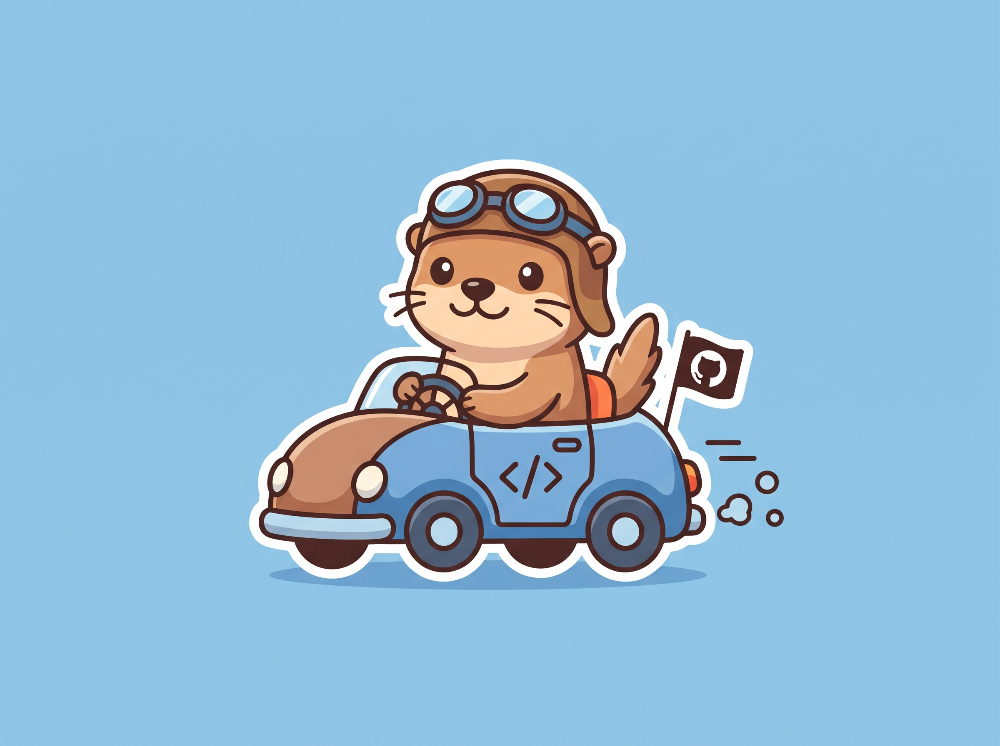

<p align="center">
  
</p>

# Optimizing Travel Through Environmental Risk (OTTER)

**Risk-Budgeted Route Planning and Adaptive Behavior for Autonomous Driving**

A group project for CSCI 513 (USC), cluster C4 Autonomous Driving. Its library is [pyotter](pyotter/README.md).

Team: Nathan Aday, Illy Hoang, Yonsoo Kim, Rachel Lin, Tomohiko Uemura, Jeslyn Yang

## About

A careful human driver does not drive the same way everywhere. They slow down in fog, avoid a hard left turn when the sun is in their eyes, and pick an easier route when the weather is bad. Most simulated driving agents do none of this: they take the quickest route and drive it the same way in all conditions.

This project builds a risk-aware route planner that sets its caution from the difficulty of the road and the vehicle's current capability. The planner predicts the risk of each road segment from known hazards such as pedestrians, wet roads, rain, fog, and low sun. It then picks the route and a speed for each segment that minimize travel time plus weighted risk.

We compare three drivers in the CARLA simulator on the same scenarios: a naive driver that takes the quickest route at the speed limit, an always-cautious driver that drives the same route slowly, and the risk-aware driver. We score each drive on travel time and on outcomes measured from the simulator, such as collisions, near-misses, and hard braking. The goal is to find out whether the risk-aware planner gets close to the safety of the cautious driver at close to the travel time of the naive one.

## Directory

| Path | Role |
|---|---|
| [`pyotter/`](pyotter/README.md) | The deliverable: the library's modules (world, planner, driver, visualize) and the runner that drives a scenario in CARLA and evaluates its telemetry |
| [`use-pyotter/`](use-pyotter/README.md) | The lab that runs pyotter on real CARLA servers: notebooks, the scenario and telemetry libraries, and the launchers for CARC, macOS, and Docker |
| [`carla-work/`](carla-work/README.md) | Intermediate work: the first-pass experiments that showed what data the project needs and how CARLA behaves. Kept for reference |
| [`docs/`](docs/) | The project plan, the team split, and the concepts |

>[!note]
> New work goes into `pyotter/` and `use-pyotter/`. 
> `carla-work/` is where the team defined early contracts, services, and schemas; most of it has been ported to Pyotter

## Status

On November 22, 2026:

- pyotter has its world, planner, driver, and visualize modules, with an offline test suite that needs no simulator.
- The naive, always-cautious, and risk-aware drivers each drove one Town10 scenario to arrival on a Mac's headless CARLA server and produced telemetry ([environments](use-pyotter/carla/README.md)).
- The CARC Discovery launcher is written and rehearsed against stand-ins for the cluster. It has not yet run on Discovery ([details](use-pyotter/README.md#status)).
- The comparison across many scenarios, which the final report needs, has not been run.

| Date | Milestone |
| :---- | :---- |
| Dec 1 | Project presentations |
| Dec 10 | Final report due |

## Getting Started

Install the library and run its tests from the repository root:

```bash
python -m venv .venv
.venv/bin/pip install -e '.[view]'
.venv/bin/python -m unittest discover -s pyotter -t .
```

The notebooks in `use-pyotter/` then build a world, plan routes, and bundle scenarios. To drive a scenario, follow [use-pyotter](use-pyotter/README.md) for CARC or [use-pyotter/carla](use-pyotter/carla/README.md) for macOS and Docker.

## Plan

- [Project plan](docs/plan.md): the goal, the drivers, the method, and how the team judges the results.
- [Teams](docs/teams.md): the World, Planner, and Runner teams, what each builds, and the APIs between them.
- [Concepts](docs/concepts.md): the penalty model, the route-and-speed search, hazards in CARLA, and why the evaluation never uses the penalty model.

[Basic Phases](docs/Basic%20Phases.md) is the plan of record, also as [PDF](docs/Basic%20Phases.pdf). The [pre-proposal](docs/prepreposal/pre-proposal-draft.md) was an early pitch, and its schedule does not apply.

## Documentation

The deliverable:

- [pyotter](pyotter/README.md): the library's architecture, concepts, and guidelines.
- [use-pyotter](use-pyotter/README.md): drive scenarios on CARC, and the scenario and telemetry libraries.
- [Driving scenarios in CARLA](use-pyotter/carla/README.md): the toolchain image, macOS, Docker, and what each hazard does in the simulator.

Intermediate work in `carla-work/`. These describe the prototype, and parts of them no longer match pyotter:

- [Headless CARLA on Apple Silicon](carla-work/docs/headless-carla.md): run the CARLA server with no window on a team Mac.
- [Planner prototype](carla-work/docs/planner.md) and its [validation notes](carla-work/docs/planner-validation.md).
- [CARLA on USC Discovery](carla-work/docs/hpc.md): the first cluster helpers, replaced by use-pyotter.
- [Record and replay a CARLA run](carla-work/docs/replay.md) in the Rerun viewer, with the [run format](carla-work/docs/run-format.md).
- [Demo driving scenarios](carla-work/docs/scenarios.md): hand-written scenarios that show what CARLA can do.
- [Reinforcement learning tutorial](carla-work/docs/reinforcement-learning.md): a DQN agent that steers from the front camera.
- [Publish a capture](carla-work/docs/publishing.md) to the public dataset [nadayusc/carla-rerun-scenarios](https://huggingface.co/datasets/nadayusc/carla-rerun-scenarios).

Course material:

- [Pre-proposal draft](docs/prepreposal/pre-proposal-draft.md), also as [LaTeX](docs/prepreposal/pre-proposal-draft.tex) and [PDF](docs/prepreposal/pre-proposal-draft.pdf). The submitted version is [pre-proposal-submission-1.pdf](docs/prepreposal/pre-proposal-submission-1.pdf).
- [Fair matching](docs/fair-matching/README.md): how the six members were assigned to the three teams.
- [Registration instructions](docs/CSCI%20513%20Project%20Registration%20Instructions.docx): the course handout.
- Background papers: [`papers/`](papers/)

External:

- [CARLA](https://github.com/carla-simulator/carla), the driving simulator
- [CARLA on Apple Silicon](https://github.com/nathanaday/carla-mac-os), how the team runs CARLA on M-series Macs
